### Personnel file: Steven Jordaan

**Field Surveyor**, attached to the Outer Survey Office on an indefinite basis.

- 🎓 **Clearance:** PhD candidate in Computer Science. BSc, Honours and Masters from the University of Pretoria.
- 🎙️ **Field training:** has lectured at UP on Automata Theory, x86 Assembly and Operating Systems.
- 🔭 **Current assignment:** multi-agent systems in educational software engineering.
- 📡 **Transmissions:** [LinkedIn](https://www.linkedin.com/in/steven-jordaan-397998166/) · [Twitter](https://twitter.com/Zandolor)

<!-- PLANET:START -->

  

  🛰️ The <b>Outer Survey Office</b> catalogues one new world every day at 00:07 UTC ·
  <a href="planets/ARCHIVE.md">past bulletins</a>

<!-- PLANET:END -->
